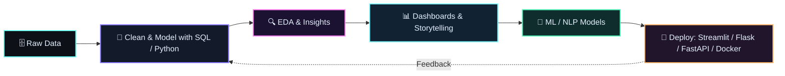

<p align="center">
  
</p>

<p align="center">
  <a href="https://readme-typing-svg.demolab.com">
    
  </a>
</p>

<p align="center">
  <a href="https://github.com/Gayathri-Reddy874"></a>
  <a href="https://www.linkedin.com/in/mallareddygari-gayathri"></a>
  <a href="mailto:gayathrireddy18125@gmail.com"></a>
  <a href="https://huggingface.co/GayathriReddy96874"></a>
  <a href="https://leetcode.com/u/M-Gayathri-Reddy/"></a>
</p>

<p align="center">
  
  
  
</p>

---

## 👋 About Me

I'm a **Data Analyst** (AI/ML Engineering graduate) who loves turning messy data into clear answers: **SQL data warehouses, exploratory analysis, dashboards, and ML-powered insights** that a business can actually act on.

My long-term goal is to become an **AI Engineer**, so alongside analytics I build with **NLP, transformers, recommender systems, and RAG / agentic applications**, and I ship them with proper engineering (tests, CI/CD, Docker).

- 📊 Designed a **Medallion-architecture (Bronze → Silver → Gold) SQL data warehouse** that surfaced **$29.4M in total revenue** insights from bike sales data.
- 🧠 Built and deployed ML apps: sentiment analysis, emotion detection, and recommender systems with clean, tested, documented code.
- 🤝 Made my **first open-source contribution** to **MLflow** (documentation PR #23551).
- 🎯 Currently: **working as a Data Analyst - Apprentice**, while building toward Data Scientist → AI/ML Engineer.

---

## 🧰 Tech Stack

### Data Analysis & BI


### Machine Learning & AI *(growing toward AI Engineer)*


### Apps, Databases & Deployment


---

## 🚀 Featured Projects

### 📊 Data Analytics

| **SQL Sales Data Warehouse & Analytics** | **Pizza Sales Analytics Dashboard** |
| --- | --- |
| End-to-end warehouse using **Medallion architecture (Bronze/Silver/Gold)**, with analytics on bike sales data uncovering **$29.4M total revenue** insights.<br>**Stack:** `SQL` `ETL` `Data Modeling`<br>[](https://github.com/Gayathri-Reddy874?tab=repositories) | Interactive dashboard analysing pizza sales trends, top products and peak periods to support business decisions.<br>**Stack:** `Dashboarding` `KPIs` `Data Visualization`<br>[](https://github.com/Gayathri-Reddy874?tab=repositories) |
| **SegmentIQ - Customer Segmentation** | **Career-Guide App** |
| Customer segmentation project turning raw customer data into actionable groups for targeting.<br>**Stack:** `Python` `Pandas` `Scikit-learn`<br>[](https://github.com/Gayathri-Reddy874/Career-guide) | Career guidance web app deployed live on Render.<br>**Stack:** `Python` `Web App` `Render`<br>[](https://github.com/Gayathri-Reddy874/Career-guide) |

### 🧠 ML / AI *(my path toward AI Engineer)*

| **E-commerce Review Sentiment Analyzer** | **Emotion AI App** |
| --- | --- |
| DistilBERT sentiment classifier on real Amazon reviews, with `WeightedTrainer` for class imbalance, CI/CD and Docker.<br>**Stack:** `PyTorch` `DistilBERT` `Streamlit` `GitHub Actions` `Docker`<br>[](https://github.com/Gayathri-Reddy874?tab=repositories) | DistilRoBERTa emotion detection with a layered architecture, **24 unit tests** and interactive Plotly visualizations.<br>**Stack:** `DistilRoBERTa` `Plotly` `Pytest` `Streamlit`<br>[](https://github.com/Gayathri-Reddy874?tab=repositories) |
| **Enterprise AI Assistant (Multi-Agent RAG)** | **Transformer Playground** |
| Multi-agent RAG assistant (research, retrieval, SQL, report, validation agents) with a FastAPI backend, Streamlit UI and JWT auth.<br>**Stack:** `FastAPI` `Pinecone` `FAISS` `AWS Bedrock` `MySQL`<br>[](https://github.com/Gayathri-Reddy874?tab=repositories) | Seven Hugging Face tasks in one app with lazy model loading and a Dockerfile.<br>**Stack:** `Hugging Face` `Transformers` `Docker`<br>[](https://github.com/Gayathri-Reddy874?tab=repositories) |
| **CineMatch - Movie Recommender** | **Folio - Book Recommender** |
| Content-based recommender on the TMDB 5000 dataset with OMDb API enrichment.<br>**Stack:** `Cosine Similarity` `Streamlit` `APIs`<br>[](https://github.com/Gayathri-Reddy874?tab=repositories) | Book recommender using CountVectorizer + cosine similarity.<br>**Stack:** `Scikit-learn` `Streamlit`<br>[](https://github.com/Gayathri-Reddy874?tab=repositories) |

### 🚀 All GitHub Projects

[](https://github.com/Gayathri-Reddy874?tab=repositories)

---

## 📈 GitHub Analytics

<p align="center">
  
  
</p>
<p align="center">
  
</p>

---

## 🧭 How I Work: Analytics → AI Engineering



- **Data Warehousing:** Medallion architecture, ETL, data modeling, analytical SQL.
- **Analysis & BI:** EDA, KPI design, dashboards, business storytelling.
- **Applied ML / NLP:** Transformers, recommender systems, class-imbalance handling, evaluation.
- **Engineering Practices:** Unit tests, CI/CD with GitHub Actions, Docker, clean README documentation.

---

## 🗺️ Career Roadmap

| Stage | Focus | Status |
| --- | --- | --- |
| **Now** | Data Analyst (Apprentice): SQL, Python, dashboards, business insights | 🟢 In role |
| **Next** | Data Scientist: statistics, ML modeling, experimentation | 🟡 Building |
| **Long-term** | AI / ML Engineer: LLMs, RAG, agents, MLOps at scale | 🔵 Goal |

---

## 💼 Experience

- **Data Analyst - Apprentice — Colt Technology Services** | *Start date – Present*
  Working with real business data: SQL querying, analysis, dashboards and reporting.
  <!-- ✏️ Add your start date and 2-3 quantified bullets (e.g. "Built X dashboard used by Y team, cutting reporting time by Z%") -->

- **Data Science Intern — Take It Smart (OPC) Pvt Ltd**
  Hands-on work across the data science workflow: data handling, analysis and modeling.
  <!-- ✏️ Add 2 quantified bullets and your internship dates here -->

---

## 🏆 Education, Achievements & Certifications

- 🎓 **B.E. in AI & Machine Learning Engineering** — CGPA **9.07 / 10**
- 🏅 **Best Performer** recognition
- 🪟 **Microsoft Applied Skills** credential
- 🌐 Certifications from Microsoft, Cisco, Coursera and more
- 🤝 **Open-source:** documentation contribution to **MLflow** (PR #23551)

---

## 📬 Let's Connect

I'm working as a **Data Analyst – Apprentice** and always happy to talk about data, analytics and AI, or to collaborate on projects.

<p align="center">
  <a href="https://www.linkedin.com/in/mallareddygari-gayathri"></a>
  <a href="mailto:gayathrireddy18125@gmail.com"></a>
  <a href="https://huggingface.co/GayathriReddy96874"></a>
  <a href="https://leetcode.com/u/M-Gayathri-Reddy/"></a>
  <a href="https://github.com/Gayathri-Reddy874?tab=repositories"></a>
</p>

```
> Turning data into decisions today.
> Building intelligent systems tomorrow.
```

<p align="center">
  
</p>
